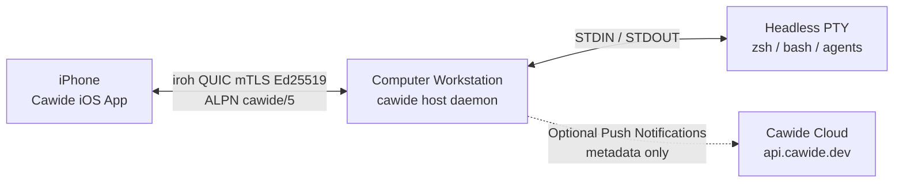

<p align="center">
  
</p>

<h1 align="center">Cawide</h1>

<p align="center">
  <strong>Your coding agent is waiting. Approve it from your iPhone.</strong>
</p>

<p align="center">
  <a href="https://github.com/Hermillon/cawide/actions/workflows/ci.yml"></a>
  <a href="https://www.npmjs.com/package/cawide"></a>
  <a href="LICENSE"></a>
  <a href="https://scorecard.dev/viewer/?site=github.com/Hermillon/cawide"></a>
</p>

<p align="center">
  <a href="https://cawide.dev">Website</a> ·
  <a href="docs/architecture.md">Architecture</a> ·
  <a href="SECURITY.md">Security</a> ·
  <a href="https://github.com/Hermillon/cawide/discussions">Discussions</a>
</p>

---

## What is Cawide?

Cawide is the open-source host daemon for the Cawide iOS app. It runs locally on your development machine (macOS, Linux, or Windows) and gives you an instant, secure mobile cockpit for running, steering, and approving AI coding agents from your phone.

- **Resilient Sessions**: Shell processes and agent CLI sessions persist in headless pseudo-terminals backed by circular ring buffers. Network transitions (Wi-Fi ↔ 5G), subway drops, and phone lock screens never kill your commands or agents.
- **Agent Intelligence**: Native telemetry hooks and status monitoring detect 9 coding agents out of the box: `claude`, `codex`, `omp`, `opencode`, `aider`, `cline`, `roo-code`, `goose`, and `cursor-agent`.
- **Git & Diff Inspection**: Inspect staged and modified diffs directly on mobile with a fast, touch-friendly diff engine.
- **Workspace Navigation**: Browse and read workspace files protected by strict jail boundaries.
- **Localhost Port Tunneling**: Preview web apps running on localhost (e.g. Vite, Next.js) securely in the Cawide in-app browser through encrypted QUIC tunnels.

---

## How It Works

Cawide establishes direct, encrypted peer-to-peer QUIC connections between your iPhone and your host workstation via Iroh:



---

## Installation

### Via npm (Recommended)

Install the global CLI wrapper for your platform (macOS, Linux, Windows):

```bash
npm install -g cawide
```

### Standalone Prebuilt Binaries

Download signed, precompiled binaries directly from [GitHub Releases](https://github.com/Hermillon/cawide/releases). You can verify build provenance using the GitHub CLI:

```bash
gh attestation verify cawide-<target>.tar.gz --repo Hermillon/cawide
```

---

## Quick Start

1. Start Cawide in your project workspace:
   ```bash
   cawide serve --workdir ~/project
   ```
2. Scan the generated QR code in **Cawide for iPhone** to pair your device.
3. Your terminal and coding agents are now live on your phone.

---

## Command Reference

| Command | Description |
|:---|:---|
| `cawide serve` | Start the host daemon (background daemon by default; foreground with `-f`/`--foreground`) |
| `cawide status` | Show host node ID, active session count, connected status, and pairing state (`--json` supported) |
| `cawide logs` | View daemon logs (`-f`/`--follow` to stream output, `-n <lines>` for line count) |
| `cawide stop` | Cleanly terminate the running daemon |
| `cawide pair` | Issue a fresh pairing ticket and QR code from a running daemon |
| `cawide devices` | List authorized paired devices and their node IDs |
| `cawide revoke <id>` | Revoke an authorized device by key or name |
| `cawide open <port|url>` | Open a localhost port or URL in the Cawide browser on your connected phone |
| `cawide setup <agent>` | Install shell integration hooks for an agent (`claude`, `codex`, `omp`, `opencode`) |
| `cawide hook <agent>` | Emit an agent event or lifecycle state to the daemon |
| `cawide login` | Link this computer to your Cawide account |
| `cawide logout` | Unlink this computer from your Cawide account |
| `cawide profile` | Manage and sync AI agent settings and profiles |
| `cawide --version` | Display version and build information |

---

## Security & Privacy Model

Cawide is built with a zero-trust architecture designed for safe remote terminal access:

- **Trust-On-First-Use (TOFU) Pairing**: Pairing runs over ephemeral ALPN `cawide/pair/1` with a single-use 32-byte secret valid for 5 minutes. No unauthenticated device can initiate sessions.
- **Mutual TLS 1.3 with Raw Ed25519**: Interactive sessions run over ALPN `cawide/5`. Handshakes authenticate node IDs against `~/.config/cawide/authorized_keys` before any stream is accepted.
- **Zero Inbound Port Exposure**: Connections use NAT hole-punching and authenticated DERP relay fallbacks. You do not need to open router firewall ports or configure dynamic DNS.
- **Workspace Jail**: All filesystem operations are strictly jailed to the configured workspace root. Absolute paths, directory traversal (`..`), and external symlinks are rejected.
- **Hardened Git Runner**: The internal Git engine strips environment variables, disables external diff drivers, ignores repository-controlled hooks, and isolates Git child processes in independent process groups.
- **Privacy by Design**:
  - Your source code, terminal keystrokes, and shell output never leave your direct encrypted peer-to-peer connection.
  - When push notifications are enabled in the mobile app, only minimal non-sensitive metadata is sent to `api.cawide.dev` (`channel_id`, `host_node_id`, `host_name`, `session_id`, `agent`, `kind`). Terminal buffers, file contents, and repository details are never transmitted.

---

## Building from Source

### Prerequisites

- Rust stable (1.80+) installed via [rustup](https://rustup.rs)
- Node.js ≥ 18 (for npm packaging)

```bash
# Clone the repository
git clone https://github.com/Hermillon/cawide.git
cd cawide

# Build the host daemon binary
cargo build --release -p cawide-host

# Run tests
cargo test --workspace
```

---

## Contributing

Contributions are welcome! Please read [CONTRIBUTING.md](CONTRIBUTING.md) for local testing instructions and contribution guidelines. All commits must include a DCO sign-off (`git commit -s`).

---

## Security

To report a vulnerability, please consult our [Security Policy](SECURITY.md) and report privately via [GitHub Security Advisories](https://github.com/Hermillon/cawide/security/advisories/new).

---

## License & Trademarks

- **Code**: Licensed under the [Apache License, Version 2.0](LICENSE).
- **Trademarks**: "Cawide" and the Cawide logo are trademarks of Đỗ Đăng Long. See [TRADEMARKS.md](TRADEMARKS.md) for guidelines.

---

<p align="center">
  <sub>Cawide for iPhone — coming soon on the App Store · <a href="https://cawide.dev">cawide.dev</a></sub>
</p>
