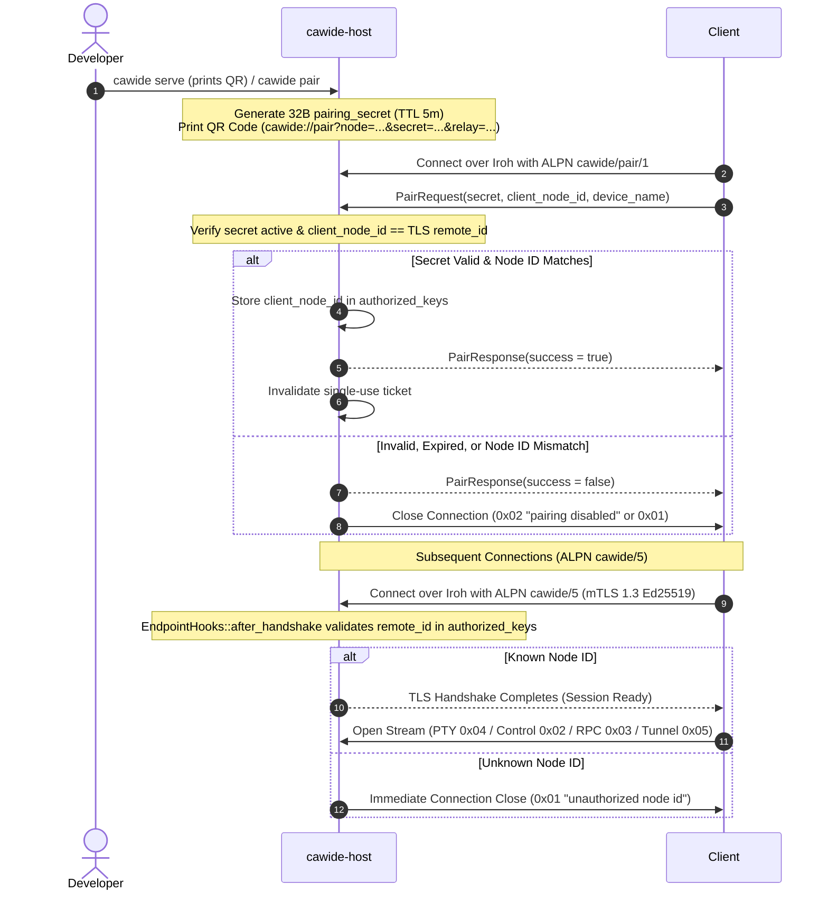

# Cawide Architecture Specification

## 1. Threat Model & Cryptographic Pairing

Unauthenticated PTY access is Remote Code Execution (RCE). Cawide enforces Trust-On-First-Use (TOFU) with ephemeral QR pairing and mutual TLS 1.3 raw Ed25519 authorization across two distinct ALPN protocols:

1. **`cawide/pair/1` (Enrollment)**:
   - Accepted only while a pairing ticket is active on the host.
   - Ephemeral 32-byte pairing secret is single-use with a TTL of 5 minutes.
   - When `PairRequest` arrives, `PairRequest.client_node_id` MUST equal the TLS connection's authenticated `remote_id`.

2. **`cawide/5` (Sessions)**:
   - Mutual TLS 1.3 with raw Ed25519 keys.
   - `EndpointHooks::after_handshake` checks the client's public key against `~/.config/cawide/authorized_keys` and closes unknown keys immediately with code `0x01` (`CLOSE_UNAUTHORIZED`, reason: `"unauthorized node id"`) before any QUIC stream is accepted (zero extra RTT).
   - There is NO in-band challenge-response; TLS 1.3 CertificateVerify already proves key possession. Do not reintroduce AuthChallenge/AuthResponse.



### Connection Close Codes:
- `0x01` (`CLOSE_UNAUTHORIZED`): Unknown node ID rejected in `after_handshake`.
- `0x02` (`CLOSE_PAIRING_DISABLED`): Connection rejected because pairing mode is inactive or expired.
- `0x03` (`CLOSE_UNSUPPORTED_ALPN`): Connection attempted with an unsupported ALPN.

### Stream Error Codes:
- `0x10` (`STREAM_ERR_UNKNOWN_PURPOSE`): Stream opened with an unrecognized purpose header byte.
- `0x11` (`STREAM_ERR_INVALID_SESSION`): Stream attach requested an unknown or stale session ID.
- `0x12` (`STREAM_ERR_SPAWN_FAILED`): Process/PTY spawn failed on host.
- `0x13` (`STREAM_ERR_PROTOCOL`): Framing or serialization violation on an accepted stream.
- `0x14` (`STREAM_ERR_SESSION_OCCUPIED`): Stream attach rejected because session is claimed by another paired device (INV-NET-004).
- `0x15` (`STREAM_ERR_SESSION_TAKEN`): Previous terminal stream reset when same device attaches a new stream to the same session.
- `0x16` (`STREAM_ERR_SESSION_GONE`): Reconnect re-attach (`resume: true`) requested for an unknown session ID.

### Pairing URI Contract:
- Format: `cawide://pair?node=<64 hex>&secret=<64 hex>[&relay=<pct-encoded>][&addr=<pct-encoded ip:port>]*`
- Parameters: `node` (host Ed25519 node ID, 64 hex chars), `secret` (ephemeral 32-byte secret, 64 hex chars), optional `relay` URL, and up to 8 direct socket `addr` candidates.
- Parsing & validation: Enforces exact scheme/host, non-duplicate 64-hex node and secret, valid percent-encoding, at most 8 IP:port addresses, and rejects unknown query parameters.

### Authorization Store:
- Location: `~/.config/cawide/authorized_keys`
- Format: Plaintext newline-separated entries: `<hex_public_key> <added_at_unix_ts> <device_name>`.
- Unrecognized or unauthenticated keys are immediately dropped at the transport boundary before any stream or command execution can occur.

---

## 2. Wire Protocol & RFC 9000 Stream Multiplexing

Two ALPNs: `cawide/5` (sessions) and `cawide/pair/1` (enrollment). All communication uses a single authenticated Iroh QUIC connection. RFC 9000 dynamically allocated bidirectional streams (`connection.open_bi()`) are identified by an initial **1-byte Stream Purpose Header**:

- `0x04` = `PTY_STREAM` (Bidirectional byte pipe: framed attach ack, then raw bytes)
- `0x02` = `CONTROL_STREAM` (Framed Postcard messages: Pairing, Resize, Keepalive, Agent Events, Session State)
- `0x03` = `RPC_STREAM` (Framed Postcard requests/responses: FS, Git; negotiated zstd response compression via `RPC_CAP_ZSTD (0x01)` in trailing byte when caps != 0 and `RPC_FLAG_COMPRESSED = 0x8000_0000` bit 31 flag)
- `0x05` = `TUNNEL_STREAM` (Bidirectional raw TCP pipe: framed TunnelOpen / TunnelAck, then raw bytes)

### 2.1 PTY Stream (`0x04`)
Host replies with a length-prefixed `PtyAttachAck` (`Replay`, `Snapshot`, or `SnapshotGzip`) before streaming raw bytes, or u32-BE length-prefixed chunk frames (bit 31 = zstd) when accept_chunked_output is negotiated (ack length bit 31).

1. **Connection Header**:
   Immediately after the `0x04` stream purpose byte, the client sends a 2-byte big-endian length prefix followed by Postcard-serialized `PtyAttachHeader`:
   ```rust
   #[derive(Serialize, Deserialize, Debug)]
   pub struct PtyAttachHeader {
       pub session_id: String,
       pub last_ack_offset: u64,
       pub resume: bool,
       pub accept_compressed_snapshot: bool,
       pub accept_chunked_output: bool,
       pub accept_input_mode_frames: bool,
   }
   ```
   When `accept_input_mode_frames` and chunked output are negotiated, the host emits 1-byte input-mode frames (flag bit 30) signaling the active terminal line-discipline state:

   | Flags | Mode | Description |
   |:---|:---|:---|
   | `ECHO \| CANONICAL` (`0x03`) | Cooked | Standard line-buffered shell input with local echo |
   | `CANONICAL` (`0x02`) | Hidden Line Input | Line-buffered input with echo suppressed (password prompts) |
   | `0` (`0x00`) | Raw | Immediate key-by-key input without echo (full-screen TUIs) |
   - `resume: false`: Explicit user attach. Spawns session using configured or default command if missing or dead.
   - `resume: true`: Automatic re-attach after reconnection. Never spawns new process: if `session_id` is unknown, host immediately resets stream with `0x16` (`STREAM_ERR_SESSION_GONE`); if session process has already exited, host sends attach ack, replays retained ring buffer from `last_ack_offset`, then calls `finish()` (client maps this cleanly to session exit).
2. **Replay & Screen Snapshot Synchronization**:
   - Host tracks monotonic `head_offset` (total bytes written since session launch) and `tail_offset` (oldest retained offset in the circular ring buffer) alongside a headless `vt100` parser.
   - If `tail_offset <= last_ack_offset <= head_offset`: Host sends `PtyAttachAck::Replay { offset: last_ack_offset }` and replays slice `last_ack_offset .. head_offset` directly onto the PTY stream.
   - If `last_ack_offset < tail_offset` or past `head_offset`: Host replies with `PtyAttachAck::Snapshot { offset: head_offset, history, screen }` (or compressed `PtyAttachAck::SnapshotGzip` when negotiated via `accept_compressed_snapshot`), redrawing the visible screen cleanly. For a normal-screen session the snapshot carries up to 10,000 lines (4 MiB) of history, and the client replaces its local scrollback with it, so a resync neither drops nor duplicates lines; an alt-screen snapshot carries no history and only redraws the screen. If an attached client falls behind the ring buffer during high-speed output, the host resets the stream with `0x17` (`STREAM_ERR_RESYNC`), prompting the client to re-attach and receive a fresh screen snapshot.
3. **Live Pipe**:
   After replay completes, the stream transitions seamlessly to a raw byte pipe:
   - Host writes raw PTY master fd stdout/stderr bytes directly into the QUIC stream.
   - Client writes keystrokes and escape sequences directly into the stream, which host forwards to PTY master stdin.

### 2.2 Control Stream (`0x02`)
Framing: 4-byte big-endian payload length prefix + `postcard` serialized payload.

```rust
#[derive(Serialize, Deserialize, Debug, Clone)]
pub enum ControlMessage {
    PairRequest {
        pairing_secret: [u8; 32],
        client_node_id: [u8; 32],
        device_name: String,
    },
    PairResponse {
        success: bool,
        error: Option<String>,
        host_name: Option<String>,
    },
    Resize {
        cols: u16,
        rows: u16,
    },
    Ping {
        client_ts: u64,
    },
    Pong {
        client_ts: u64,
        host_ts: u64,
    },
    HostEvent(HostEvent),
}

#[derive(Serialize, Deserialize, Debug, Clone)]
pub enum HostEvent {
    /// Repository at `root` changed via a mutating `Git { op }` RPC or outside filesystem edits.
    GitChanged { root: String },
    /// Workspace-relative paths changed on disk; empty vec = refresh entire file tree.
    FsChanged { paths: Vec<String> },
    /// Session created, killed, or exited with status code.
    SessionsChanged,
    /// Real-time AI agent telemetry update.
    AgentStatusChanged { session_id: String, state: AgentState },
    /// Control stream buffer overflow / lag: client must refetch all workspace and session state.
    Resync,
}

#[derive(Serialize, Deserialize, Debug, Clone)]
pub struct AgentState {
    pub agent: String,
    pub status: AgentStatus,
    pub updated_ts: u64,
}

#[derive(Serialize, Deserialize, Debug, Clone)]
pub enum AgentStatus {
    Idle,
    Thinking { task_desc: String },
    WaitingForInput { prompt: String, options: Vec<String> },
    Completed { summary: String },
}

#[derive(Serialize, Deserialize, Debug, Clone)]
pub struct SessionSummary {
    pub session_id: String,
    pub workdir: String,
    pub active_cmd: Option<String>,
    pub last_active_ts: u64,
    pub alive: bool,
    pub exit_code: Option<i32>,
    pub attached: bool,
    pub agent: Option<AgentState>,
}
```

> **Note**: Every Control stream subscribes to host events when it opens. Events are interleaved with replies by a single writer, so a client that has received any reply (e.g. `Pong`) will receive all later events. If a slow client lags behind the broadcast channel (`RecvError::Lagged`), the host sends `HostEvent::Resync`.

### 2.3 RPC Stream (`0x03`)
Framing:
- **Request**: Request ID (`u32` big-endian) + 4-byte big-endian payload length + `postcard` payload (max 16 MB). When client advertises capabilities (`caps != 0`), a trailing capability byte (`RPC_CAP_ZSTD = 0x01`) is appended within the frame length payload; when `caps == 0`, no trailing byte is written, producing byte-identical legacy framing.
- **Response**: Request ID (`u32` big-endian) + 4-byte big-endian length prefix + payload. Response compression is indicated by bit 31 on the length prefix (`RPC_FLAG_COMPRESSED = 0x8000_0000`). When set, the masked length includes a 4-byte big-endian uncompressed length prefix followed by zstd-compressed payload (negotiated via `RPC_CAP_ZSTD` for responses >= 1024 bytes when compressed size is strictly smaller than uncompressed).
Requests on one stream are served sequentially and answered in order with the same Request ID; clients open additional RPC streams for parallelism.

```rust
pub const MAX_FILE_SIZE: u64 = 500 * 1024;              // FsRead cap (INV-FS-002)
pub const MAX_CHUNKED_FILE_SIZE: u64 = 64 * 1024 * 1024; // FsReadChunk cap
pub const FS_READ_CHUNK_MAX_BYTES: u32 = 4 * 1024 * 1024; // Max chunk size
pub const MAX_DIFF_BYTES: usize = 200 * 1024;           // GitDiff cap (INV-GIT-001)
pub const FS_UPLOAD_MAX_BYTES: usize = 8 * 1024 * 1024; // FsUpload cap (INV-FS-003)
pub const FS_SEARCH_MAX_VISITED_ENTRIES: usize = 20_000;
pub const FS_SEARCH_MAX_RESULTS: usize = 100;
pub const MAX_SESSIONS: usize = 32;                     // Session retention limit

#[derive(Serialize, Deserialize, Debug)]
pub enum RpcRequest {
    FsList { path: String, recursive: bool },
    FsRead { path: String, offset: u64, length: u32 },
    FsSearch { query: String },
    FsUpload { filename: String, data: Vec<u8> },
    RemoteOpen { target: String },
    Git { root: String, op: GitOp },                     // envelope for every git operation (status, diff, stage, commit, branches, remotes, stash, …)
    ForgeAccounts { op: ForgeAccountOp },                // forge account / credential / SSH trust management
    Forge { root: String, account: Option<String>, op: ForgeRepoOp }, // pull requests, reviews, checks, merge
    SessionList,
    SessionCreate { session_id: String, command: Option<String> },
    SessionKill { session_id: String },
    FsReadChunk { path: String, offset: u64, length: u32 },
}

#[derive(Serialize, Deserialize, Debug)]
pub enum RpcResponse {
    FsList(Result<Vec<FsEntry>, String>),
    FsRead(Result<FsReadResult, String>),
    FsSearch(Result<Vec<FsSearchResult>, String>),
    FsUpload(Result<String, String>), // absolute host path of the stored file
    RemoteOpen(Result<(), String>),
    Git { result: Result<GitReply, GitError> },
    ForgeAccounts { result: Result<ForgeAccountReply, ForgeError> },
    Forge { result: Result<ForgeRepoReply, ForgeError> },
    SessionList(Result<Vec<SessionSummary>, String>),
    SessionCreate(Result<SessionSummary, String>),
    SessionKill(Result<(), String>),
    FsReadChunk(Result<FsChunk, String>),
}

#[derive(Serialize, Deserialize, Debug, Clone)]
pub struct FsEntry {
    pub name: String,
    pub path: String, // workspace-relative
    pub is_dir: bool,
    pub size: u64,
    pub modified_ts: u64,
}

#[derive(Serialize, Deserialize, Debug, Clone)]
pub struct FsReadResult {
    pub data: Vec<u8>,   // empty when too_large
    pub too_large: bool, // file > MAX_FILE_SIZE
    pub total_size: u64,
}

#[derive(Serialize, Deserialize, Debug, Clone)]
pub struct FsChunk {
    pub data: Vec<u8>,
    pub too_large: bool,
    pub total_size: u64,
    pub modified_unix_ns: u64,
}

#[derive(Serialize, Deserialize, Debug, Clone)]
pub struct FsSearchResult {
    pub path: String,            // workspace-relative
    pub score: u32,              // results sorted by descending score
    pub match_indices: Vec<u32>, // char (not byte) indices into `path`, ascending
}

#[derive(Serialize, Deserialize, Debug, Clone)]
pub struct GitStatusSummary {
    pub branch: String, // "HEAD (detached)" when detached
    pub staged_files: Vec<String>,
    pub modified_files: Vec<String>,
    pub untracked_files: Vec<String>,
    pub conflicted_files: Vec<String>,
}

#[derive(Serialize, Deserialize, Debug, Clone)]
pub struct GitDiffResult {
    pub hunks: Vec<DiffHunk>, // empty when too_large
    pub too_large: bool,      // combined diff > MAX_DIFF_BYTES
    pub total_bytes: u64,
}

#[derive(Serialize, Deserialize, Debug, Clone)]
pub struct DiffHunk {
    pub file_path: String,
    pub old_start: u32,
    pub old_lines: u32,
    pub new_start: u32,
    pub new_lines: u32,
    pub header: String,
    pub lines: Vec<DiffLine>,
}

#[derive(Serialize, Deserialize, Debug, Clone)]
pub struct DiffLine {
    pub kind: DiffLineKind,
    pub content: String, // without the leading '+', '-' or ' ' marker
}

#[derive(Serialize, Deserialize, Debug, Clone, PartialEq, Eq)]
pub enum DiffLineKind {
    Context,
    Addition,
    Deletion,
}
```

### 2.4 Tunnel Stream (`0x05`)
Immediately after the `0x05` stream purpose byte, the client sends a 2-byte big-endian length prefix followed by Postcard-serialized `TunnelOpen`:
```rust
#[derive(Serialize, Deserialize, Debug, Clone, PartialEq, Eq)]
pub struct TunnelOpen {
    pub host: String,
    pub port: u16,
}
```
The host validates the target, resolves DNS from its local network environment, and connects via TCP with a 9-second total budget. It responds with a 2-byte big-endian length prefix followed by Postcard-serialized `TunnelAck`:
```rust
#[derive(Serialize, Deserialize, Debug, Clone, PartialEq, Eq)]
pub enum TunnelAck {
    Connected,
    Failed { reason: TunnelFailure, message: String },
}
```
Upon `TunnelAck::Connected`, the QUIC stream becomes a transparent, bidirectional byte pipe spliced directly to the host's target TCP socket until either side closes or resets the connection.

### 2.5 RPC Engine Security (`crates/cawide-host/src/rpc`)

- **Workspace Jail (INV-FS-001)**: every client path goes through `rpc::jail::resolve_jailed_path`. A leading `/` is workspace-relative. `..`/root components and NUL bytes are rejected outright. Dangling symlinks are rejected anywhere on the path. The deepest existing ancestor is canonicalized and must lie inside the canonical workspace root. Symlinks that resolve inside the workspace are allowed.
- **Filesystem**:
  - `FsList`/`FsSearch` prune `.git`, `node_modules`, `target`, `build` and `dist`. Recursive listing is bounded to depth 8 and 2,000 entries.
  - `FsRead` checks size on the opened handle, so the checked file is the file read.
- **Uploads (INV-FS-003)** are written to `~/.cache/cawide/uploads/` (`0700` dir, `0600` files):
  - Filenames are sanitized to `[A-Za-z0-9._-]` and prefixed with `<unix_secs>_<random>_`.
  - Files are written via a temp file and moved into place with an atomic no-clobber rename.
- **`RemoteOpen`** accepts only:
  - `http(s)` URLs with no whitespace or control characters;
  - regular, non-executable files inside the jail whose extension is not executable or installable (`sh`, `app`, `command`, `pkg`, `dmg`, `exe`, …).
- **Git (INV-GIT-001/002/003, INV-LFS-001)** lives in `crates/cawide-host/src/rpc/git/`. Every operation arrives as the `Git { root, op: GitOp }` envelope and is routed by `rpc::git::dispatch`. The engine shells out to the `git` CLI with repository-controlled code execution disabled:
  - Hardening flags: `--no-pager --literal-pathspecs -c core.fsmonitor=false -c core.hooksPath=/dev/null -c diff.external= -c commit.gpgSign=false -c tag.gpgSign=false -c core.quotePath=false -c color.ui=false -c core.askPass= -c credential.interactive=never -c protocol.ext.allow=never`. Diffs also run with `--no-ext-diff --no-textconv`.
  - Process isolation (`rpc::process`): each child calls `setsid()` in `pre_exec`, so it leads its own session and process group with no controlling terminal. On timeout or cancellation the whole group is killed with `killpg(SIGTERM)`, then `killpg(SIGKILL)` if it is still alive after 2 s.
  - Every configured `filter.<driver>` is discovered per request, including through `include.path`. Each is neutralized via `GIT_CONFIG_COUNT`/`GIT_CONFIG_KEY_n`/`GIT_CONFIG_VALUE_n`: `clean`/`smudge`/`process` are set to empty and `required` to false. This is needed because Git ignores `filter.*` wildcards.
  - `GIT_DIR`, `GIT_WORK_TREE`, `GIT_INDEX_FILE`, `GIT_CONFIG_PARAMETERS` and `GIT_EXTERNAL_DIFF` are stripped from the environment.
  - Paths starting with `-` or `:` are rejected before reaching Git.
  - Diff output is read with a cap, so oversized diffs are never buffered in full.
  - LFS: staged paths are checked with path-scoped `git check-attr filter`, so LFS-tracked files are never committed as unsmudged binaries. Whole-tree mutations in an LFS repository fail fast with `GitErrorKind::LfsUnavailable` when `git-lfs` is missing.
  - SSH remotes (INV-SSH-001) run `ssh -o BatchMode=yes -o StrictHostKeyChecking=yes` against `~/.ssh/known_hosts` plus Cawide's own known-hosts file. Unknown host keys are scanned and trusted only after the user confirms the fingerprint on the client; a changed host key returns `HostKeyChanged` and cannot be trusted from the app.
  - A successful mutating `GitOp` (`GitOp::is_mutating()`) broadcasts `HostEvent::GitChanged { root }`.

### 2.6 Workspace Watcher & Classification Engine (`crates/cawide-host/src/watch.rs`)
The host workspace watcher detects filesystem modifications made outside RPC requests (e.g. autonomous agent edits or terminal commands) and translates them into debounced `HostEvent::FsChanged` and `HostEvent::GitChanged` notifications:
- **Debouncer**: Uses `notify_debouncer_full` with 250 ms debounce duration and `NoCache` (`notify_debouncer_full::NoCache`). `NoCache` is critical to avoid full filesystem tree walks on macOS (`FileIdMap`).
- **Path Resolution**: Canonicalizes event paths and relativizes them against the canonical workspace root.
- **Classification Rules**:
  - `need_rescan()` or path equals workspace root -> `FsChanged { paths: vec![] }` (full reload) and `GitChanged`.
  - Path outside workspace root -> ignored.
  - `.git/index`, `.git/HEAD`, or path starting with `.git/refs/` -> git dirty; other `.git/**` paths -> ignored.
  - First path component matches `is_skipped_dir` (`node_modules`, `target`, `build`, `dist`, `.cache`, `.git`, etc.) -> ignored.
  - Matched by root `.gitignore` (`ignore::gitignore::Gitignore`, dynamically rebuilt when `.gitignore` changes) -> ignored.
  - Otherwise, relative path is added to changed set and marked git dirty.
- **Event Dispatch**: Emits once per batch union. If changed set is non-empty, emits `FsChanged { paths }` (sorted, deduped; if > 200 paths, sends empty vec). Followed by `GitChanged` if git is dirty. Debouncer error batches emit `FsChanged { paths: vec![] }` and `GitChanged`.
- **Home Guard**: When `cawide serve` runs with `workdir == $HOME`, the watcher is disabled to prevent filesystem thrashing across the user's home directory.

### 2.7 Forge Engine (`crates/cawide-host/src/forge`)
The forge engine serves `ForgeAccounts { op }` and `Forge { root, account, op }` RPCs through native REST adapters; no forge CLI is required at request time.
- **Adapters** (`forge/adapters/`): GitHub, GitLab, Gitea, Bitbucket and Azure DevOps each implement repository lookup, pull requests, files/diffs, review threads, checks and merge against their REST APIs. Unrecognized hosts resolve to `ForgeKind::Generic`, which supports plain git only.
- **Capability gating** (`forge/capabilities.rs`): `default_capabilities(kind)` returns a fixed `ForgeCapabilities` table. `forge::dispatch` checks it before calling an adapter and returns `ForgeErrorKind::Unsupported` for gated operations. The client uses the same table to hide unsupported actions.

| Capability | GitHub | GitLab | Gitea | Bitbucket | Azure DevOps | Generic |
|:---|:---:|:---:|:---:|:---:|:---:|:---:|
| Pull requests, inline comments, request changes, checks | ✓ | ✓ | ✓ | ✓ | ✓ | – |
| Multiline comments | ✓ | ✓ | – | – | ✓ | – |
| Suggestions | ✓ | ✓ | – | – | – | – |
| Resolve / reply to threads | ✓ | ✓ | – | ✓ | ✓ | – |
| Auto-merge, drafts, reopen | ✓ | ✓ | ✓ | – | ✓ | – |
| Reviewers by login | ✓ | ✓ | ✓ | – | – | – |
| SSH key upload | ✓ | ✓ | ✓ | ✓ | – | – |

- **Account store (INV-FORGE-001)** (`forge/store.rs`): accounts and helper backups live in `<config_dir>/forge-accounts.json` (`0700` dir, `0600` file). Every read-modify-write runs inside `with_locked_store`, which holds `libc::flock(LOCK_EX)` on `forge-accounts.lock` so the daemon and `cawide git-credential` processes never race. Writes go through a temp file and an atomic rename.
- **Credential helper (INV-FORGE-002)** (`forge/helper.rs`): `cawide git-credential <get|store|erase>` is handled before tracing is initialized, so stdout carries only Git credential protocol lines. Global Git config is changed only by `ForgeAccountOp::SetTerminalHelper`. Enabling it backs up the host's existing `credential.<url>.helper` entries into the store; disabling it removes Cawide's helper and restores the backups.
- **Test endpoint overrides** (`forge/http.rs`): `ForgeHostConfig::endpoint_overrides` maps a canonical host to a replacement base URL. `ForgeHttp::url` uses it in place of `<scheme>://<host>`, so integration tests can point adapters at a local mock server. Production builds pass an empty map.
- **Live PR Detail & Checks** (`PullRequestWithChecks`): `PullRequestWithChecks` returns detail + checks in one call (GitHub: one GraphQL query; others: parallel REST with soft-failing checks except rate-limit/auth).
- **ETag Caching** (`forge/http.rs`): `ForgeHttp` ETag cache (GET only, keyed by URL + Accept + SHA-256 of Authorization, 512 entries / 32 MiB, 304 served from cache).
- **Rate-limit Classification**: 403 rate-limit classification (`x-ratelimit-remaining: 0`, `retry-after`, "rate limit" body, GraphQL `RATE_LIMITED`).

### 2.8 LAN Discovery & QUIC Keepalive
- **LAN Discovery (`_cawide._udp`)**: Hosts advertise local reachability over mDNS-SD / Bonjour (`_cawide._udp`) using instance name `cawide-<16hex>` (derived from the host's node ID). TXT records publish `v=1`, `node_id` (64 hex characters), `name` (machine name), and `addrs` (comma-separated IPv4/IPv6 socket addresses). Clients discover local daemons over mDNS-SD, establishing direct LAN QUIC connections without relay mediation.
- **QUIC Keepalive & Idle Timeout**: To minimize cellular tail energy and preserve battery on mobile devices (RFC 9308 §3.6), both host and client endpoints configure a keepalive interval of 20 seconds (`keep_alive_interval = 20s`) and a maximum QUIC idle timeout of 45 seconds (`max_idle_timeout = 45s`).

---

## 3. PTY Session Persistence & Ring Buffer

### Invariants:
1. Shell processes (`zsh`, `bash`, `fish`, or agent binaries) run under `portable-pty` in a detached Tokio task.
2. The ring buffer capacity is fixed at 4 MiB (`DEFAULT_RING_BUFFER_CAPACITY = 4 * 1024 * 1024` bytes).
3. **UTF-8 Alignment**: Ring buffer appends reject mid-sequence boundary wraps. Slicing logic validates character continuation bytes (`0x80..=0xBF`) to ensure clean UTF-8 code point starts.
4. **Screen Snapshot Synchronization**: On underrun, reconnection past head, or live ring overrun (`STREAM_ERR_RESYNC`), the host renders a clean screen snapshot via a headless `vt100` parser instead of arbitrary raw tails.

---

## 4. Local Daemon IPC & CLI Commands

### 4.1 IPC Protocol (`crates/cawide-host/src/net/ipc.rs`)
- Unix domain socket: `~/.config/cawide/cawide.sock` (0700 dir, 0600 socket file).
- Framing: 4-byte big-endian length prefix + `postcard` payload (up to 64 KiB).
- **Requests**:
  - `IpcRequest::Pair`: Generates single-use 5-minute pairing ticket and returns URI + QR text.
  - `IpcRequest::Status`: Returns host node ID, active session count, connection status, authorized keys count, pairing status, and `last_input_unix` timestamp.
  - `IpcRequest::Stop`: Cleanly terminates daemon.
  - `IpcRequest::AgentEvent { session_id, agent, status }`: Ingests agent telemetry, updates session state in registry, and broadcasts `HostEvent::AgentStatusChanged`.
  - `IpcRequest::ListDevices`: Returns list of authorized devices with node IDs and pairing timestamps.
  - `IpcRequest::RevokeDevice { selector }`: Revokes device from `authorized_keys` and terminates active QUIC connections immediately with `CLOSE_UNAUTHORIZED` (`0x01`).
- **Responses**: `Ok`, `Error(String)`, `PairTicket`, `Status`, `Devices(Vec<DeviceInfo>)`, `Revoked { node_id, device_name }`.

### 4.2 CLI Commands
- `cawide serve [--workdir <path>] [--command <cmd>] [--local-only] [--no-pair]`: Starts daemon and prints pairing QR code.
- `cawide pair`: Generates and prints a new pairing ticket / QR code from running daemon.
- `cawide status [--json]`: Prints node ID, active session count, connection status, authorized keys count, and last input timestamp. With `--json`, outputs a single-line machine-readable JSON object.
- `cawide stop`: Gracefully stops the running daemon.
- `cawide hook <agent> [--event <name>] [payload]`: Subcommand for agent hook scripts (Claude Code, OpenAI Codex CLI, OMP, OpenCode). Returns in < 5 ms, non-blocking, exits 0.
- `cawide setup <agent> [--remove]`: Atomically configures hooks in agent configuration files (`~/.claude/settings.json`, `~/.codex/config.toml`, `~/.omp/agent/extensions/cawide.js`, `~/.config/opencode/plugins/cawide.js`) with `.cawide-bak` backups.
- `cawide devices`: Lists all authorized devices (`<name>  <first 12 hex>...  added <YYYY-MM-DD>`).
- `cawide revoke <selector>`: Revokes device by exact 64-hex key, unique >= 8 hex prefix, or exact device name.
